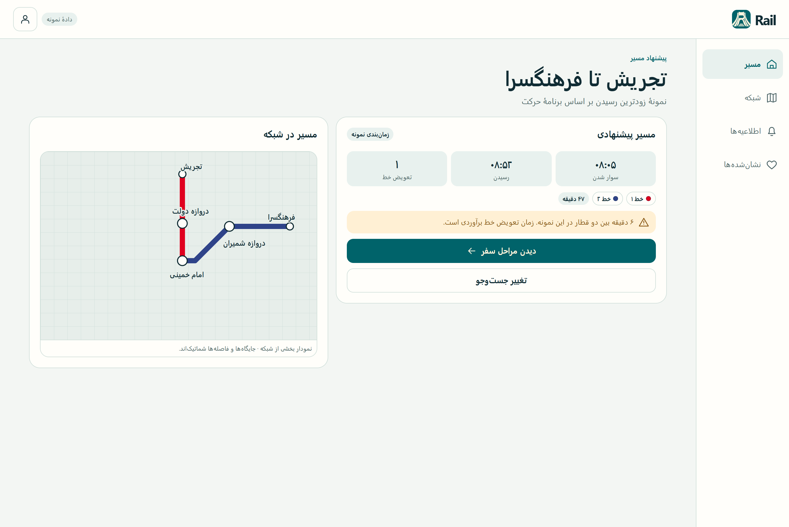
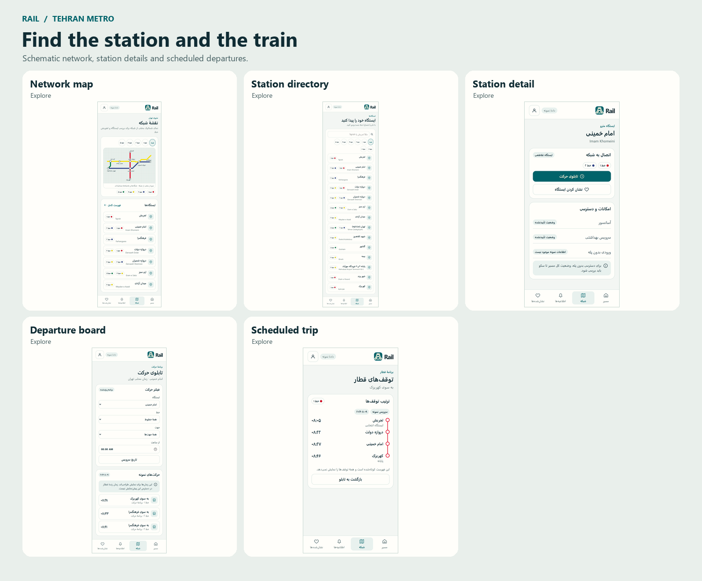

# Rail


Rail is a Persian-first companion for Tehran Metro riders. It brings journey planning, station information, scheduled departures, and service notices into one place.

The MAUI app hosts a local Vue frontend with four pages: map, stations, saved items, and settings. Shared components provide a responsive Persian RTL shell with glass-style bottom navigation; page content is a placeholder, and the appearance setting works locally. The API runs separately against SQL Server and uses the imported metro network and timetables. The [implementation handoff](Rail.Statics/Design/04-handoff/implementation-notes.md) maps the design prototype screens to the API.

## What Rail does

- Plans journeys by earliest scheduled arrival and shows boarding stations, train directions, transfers, and arrival times in Tehran local time.
- Provides Persian and English station search, nearby stations, line and branch information, amenities, and scheduled departure boards.
- Exposes trip stops, service calendars, published alerts, and fare catalog entries when those records are available.
- Supports accounts and saved stations through ASP.NET Core Identity. The prototype simulates the sign-in and favorites flows locally.

## Design preview





Open the [clickable prototype](Rail.Statics/Design/START-HERE.html) in Edge or Chrome, or browse the [screen gallery](Rail.Statics/Design/01-prototype/gallery.html). Start with the sample trip from Tajrish to Farhangsara via Imam Khomeini. The maps are schematic and the preview times and alerts are illustrative.

## Solution structure

| Project | Role | Where to start |
| --- | --- | --- |
| [Rail.Api](Rail.Api/Rail.Api.csproj) | ASP.NET Core Web API on .NET 10 with EF Core, SQL Server, and Identity | [Controllers](Rail.Api/Controllers), [models](Rail.Api/Models), and [journey planner](Rail.Api/Services/JourneyPlanner.cs) |
| [Rail.Maui](Rail.Maui/Rail.Maui.csproj) | Windows and Android .NET MAUI app with Rail branding and embedded offline pages | [App startup](Rail.Maui/App.xaml.cs), [HTML host](Rail.Maui/MainPage.xaml), and [theme colors](Rail.Maui/Resources/Styles/Colors.xaml) |
| [Rail.WebPages](Rail.WebPages/Rail.WebPages.csproj) | Vue/TypeScript frontend bundled locally by MAUI | [Components, pages, and development](Rail.WebPages/README.md) |
| [Rail.Statics](Rail.Statics/Rail.Statics.csproj) | Design and branding source files shared by the browser preview and MAUI app | [Design pack](Rail.Statics/Design/README.md) and [logo kit](Rail.Statics/Logo/README.md) |

MAUI builds the Vue source in `Rail.WebPages/src` with Vite and bundles the generated HTML, CSS, and JavaScript from `Rail.WebPages/dist`. Edit the Vue components and rebuild the app to pick up changes. The original design prototype remains available separately in `Rail.Statics/Design`.

## Run locally

### Windows app

Use Windows with the .NET 10 SDK, the .NET MAUI Windows workload, the WebView2 runtime, and Node.js 22.12+ with npm on PATH. The MAUI build restores frontend dependencies as needed and builds Vue automatically.

```powershell
dotnet build Rail.Maui/Rail.Maui.csproj -p:EnableAndroidTarget=false
```

In Visual Studio, set `Rail.Maui` as the startup project and select **Windows Machine**. The map page opens after the splash. Use the bottom navigation to switch between the four pages. The installed app works without running a web server, the API, or SQL Server. For browser development, run `npm ci` and `npm run dev` inside `Rail.WebPages`; see the [frontend guide](Rail.WebPages/README.md).

For live Vue updates inside the Windows app, keep `npm run dev` running and launch
MAUI in Debug with the **Windows Machine (Vue Dev)** profile. Save a component to
update both browser and app without rebuilding MAUI. The normal profile and all
Release builds continue to use bundled offline assets.

### Android app

Install the Android SDK and Java SDK. On Windows, the Android target appears when the project finds the SDK in Visual Studio's default location or through `ANDROID_HOME`. Set `ANDROID_HOME` to your SDK location and restart Visual Studio if you use a custom location. Then select an Android emulator or connected device for `Rail.Maui`.

```powershell
dotnet build Rail.Maui/Rail.Maui.csproj -f net10.0-android -p:EnableAndroidTarget=true
```

### API and database

The API reads `ConnectionStrings:LocalDB` and uses the `Rail` database by default. To point it at another local database, set `ConnectionStrings__LocalDB` in the launch environment.

For a fresh local database, apply the EF Core migration from the repository root. If the original `Metro` database is available on the same LocalDB instance, run the import once to populate the empty network tables. The migration requires `dotnet-ef`, and the import command uses `sqlcmd`.

```powershell
dotnet ef database update --project Rail.Api/Rail.Api.csproj --context AppDbContext
sqlcmd -S '(localdb)\MSSQLLocalDB' -d Rail -E -C -b -i Rail.Api/Data/ImportLegacyMetro.sql
```

See the [database guide](Rail.Api/Data/README.md) for import behavior and timetable conventions.

```powershell
dotnet run --project Rail.Api/Rail.Api.csproj --launch-profile https
```

Open [Swagger UI](https://localhost:7130/swagger) in Development or try the examples in [Rail.Api.http](Rail.Api/Rail.Api.http). A quick read-only check is `GET /api/network/lines`. Account email flows require SMTP settings under `Email`. Supply the SMTP password through local configuration or the `Email__Password` environment variable.

## Further reading

- [Google login setup and API client contract](Rail.Api/GOOGLE-LOGIN.md)
- [Design system and components](Rail.Statics/Design/03-design-system/components.html)
- [MAUI and API implementation handoff](Rail.Statics/Design/04-handoff/implementation-notes.md)
- [Brand and platform asset guide](Rail.Statics/Logo/README.md)
